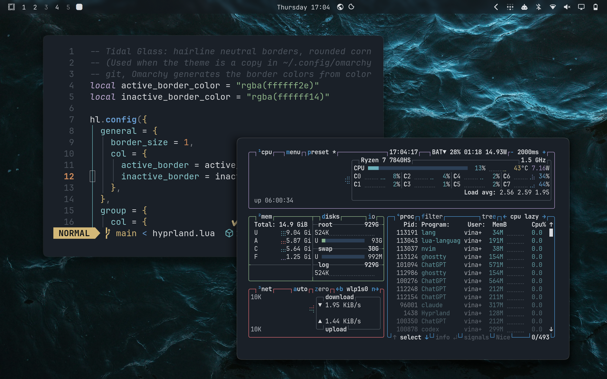

# Tidal Glass

A dark theme for [Omarchy](https://omarchy.org). Graphite blue-grey windows, one
sea-blue accent, and four photographs of cold water.



## Install

On any Omarchy system, run:

```bash
omarchy theme install https://github.com/Vinayak-Arora-324/omarchy-tidal-glass-theme.git
```

Or open the Omarchy menu (`Super + Space`), go to **Install → Style →
Theme** and paste the URL above.

Omarchy clones the repo into `~/.config/omarchy/themes/tidal-glass` and applies
it straight away. After that it shows up in the theme switcher
(`Super + Ctrl + Shift + Space`), or you can set it by name:

```bash
omarchy theme set tidal-glass
```

### Update

```bash
omarchy theme update
```

This pulls the latest version of every theme you installed from git.

### Remove

```bash
omarchy theme remove tidal-glass
```

## Files

| File | What it does |
|------|--------------|
| `colors.toml` | The palette. Omarchy builds the terminal, editor, btop and app themes from it. |
| `shell.toml` | Menus, launcher, notifications and lock screen. |
| `hyprland.lua` | 1px borders, 11px corners, window shadow. |
| `icons.theme` | `Yaru-blue-dark` |
| `backgrounds/` | The wallpapers. |

### Corners and shadows

For safety, Omarchy skips any `*.lua` file in a theme installed from git, so
`hyprland.lua` is not loaded and windows keep the default corners and shadow.
Everything else still applies. If you want the rounded corners and shadow, read
[`hyprland.lua`](hyprland.lua) first (it only sets border, rounding and shadow
values), then turn the install into a local copy:

```bash
rm -rf ~/.config/omarchy/themes/tidal-glass/.git
omarchy theme set tidal-glass
```

A local copy no longer gets `omarchy theme update`. To update it later, run the
install command again, then repeat these two lines.

## Palette

| | | | |
|---|---|---|---|
| background | `#1a2028` | foreground | `#d9dce0` |
| accent | `#4a90c8` | selection | `#2c3f55` |
| red | `#d96a70` | orange | `#cf8c5c` |
| yellow | `#d3b878` | green | `#8db388` |
| cyan | `#6bb2b8` | blue | `#6a9ed2` |
| magenta | `#a590c0` | brown | `#9a8979` |

Window borders are a plain white hairline at low opacity, a little brighter on
the focused window.

## Wallpapers

All four are from [Pexels](https://www.pexels.com/license/), cropped to 16:10
and lightly graded.

| File | Photographer |
|------|--------------|
| `1-dusk.webp` | [Gilles Quertier](https://www.pexels.com/photo/misty-rocks-on-the-sea-at-dusk-in-bretagne-33401396/) |
| `2-current.webp` | [Kris Møklebust](https://www.pexels.com/photo/dark-ocean-waves-with-reflective-light-patterns-34155535/) |
| `3-deep.webp` | [Eyüpcan Timur](https://www.pexels.com/photo/deep-dark-ocean-waves-at-twilight-33333829/) |
| `4-ripple.webp` | [Franco Garcia](https://www.pexels.com/photo/view-of-dark-blue-water-surface-18785204/) |
